# SII Planner

**Tu trayectoria académica, clara y planeada.** Aplicación web para alumnos del **TecNM Campus Celaya** que consume la
API REST del **SII** para mostrar calificaciones, kardex y horario, y agrega un **Planificador de trayectoria académica**
con backend propio: mapa de la retícula con seriación, estimación de egreso, alertas y un generador de horarios sin choques.

| | |
|---|---|
| **App** | https://examen3-topw.vercel.app |
| **API** | https://sii-planner-api.onrender.com/api/salud |
| **Panel de administración** | https://examen3-topw.vercel.app/admin |

> Proyecto del **Examen 3 — Consumo de API y Desarrollo de Interfaz Web**. Los datos académicos (login, estudiante,
> calificaciones, kardex y horario) vienen de la **API real del SII**; la retícula y la oferta de grupos del Planificador
> viven en nuestra propia base de datos.

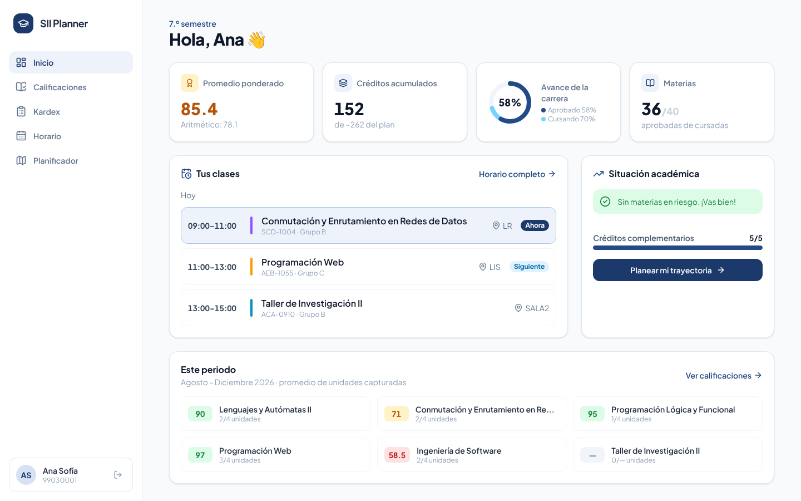

---

## Contenido

- [Funcionalidades](#funcionalidades)
- [Capturas](#capturas)
- [Arquitectura](#arquitectura)
- [Tecnologías y por qué las elegimos](#tecnologías-y-por-qué-las-elegimos)
- [Instalación local](#instalación-local)
- [Despliegue](#despliegue)
- [Estructura del repositorio](#estructura-del-repositorio)
- [Equipo](#equipo)

---

## Funcionalidades

### 1. Autenticación
- Inicio de sesión con número de control, `L` + número o correo institucional (el backend arma el correo `l<número>@celaya.tecnm.mx`).
- El token del SII se guarda en una **cookie `httpOnly`** puesta por nuestro backend: el JavaScript del navegador **nunca lo ve**.
- Errores claros: campos vacíos, credenciales incorrectas, SII caído, demasiados intentos.
- **Rutas privadas protegidas**; cuando el token (60 min) expira, la app regresa al login con un aviso.

### 2. Información del estudiante (Inicio)
Tarjetas de promedio, créditos, avance de la carrera y materias; clases de hoy con la que está en curso;
resumen del periodo. Indicadores de carga (*skeleton*) y mensajes de error con botón de reintentar.

### 3. Calificaciones
- Pestañas **Periodo actual** (calificaciones por unidad y promedio parcial) e **Historial** (todos los intentos del kardex).
- **Filtro en tiempo real** por nombre o clave (sin acentos ni mayúsculas), por periodo y por desempeño.
- **Semáforo**: verde ≥ 90 · amarillo 70–89 · rojo < 70 · gris sin datos.

### 4. Kardex y Horario
- **Kardex**: resumen (avance, créditos, promedio, repeticiones), gráfica del promedio por semestre y secciones por semestre
  con tipo de curso (ordinario, repetición, especial) y las no acreditadas resaltadas.
- **Horario**: cuadrícula días × horas, marca del día y la hora actual, y vista por día en el celular.

### 5. Funcionalidad adicional: Planificador de trayectoria académica
Cruza el **kardex real** del alumno con la **retícula oficial** de ISC (ISIC-2010-224, 260 créditos) guardada en nuestra base de datos,
con tres especialidades: *Inteligencia de Datos y Plataformas en la Nube*, *Gestión de Tecnologías Emergentes* y *Administración Gerencial*.

| Pantalla | Qué hace |
|---|---|
| **Avance** | % de créditos (aprobados, cursando, por cursar), **egreso estimado**, materias por estado, alertas (repeticiones, curso especial, límite de semestres, servicio social, residencia) y materias que puede inscribir. |
| **Mapa de retícula** | Grafo interactivo por semestre: aprobada, cursando, disponible, bloqueada o reprobada. Flechas de **pre-requisito** y líneas punteadas de **co-requisito**. Al elegir una materia se ilumina su cadena de seriación y se explica por qué está bloqueada (seriación o % de créditos). |
| **Generador de horarios** | El alumno elige materias y preferencias (turno, evitar sábado, máximo de créditos) y recibe hasta 10 combinaciones de grupos **sin choques**, ordenadas por puntuación (menos horas libres, menos días). |
| **Panel de administración** | Backend propio con sesión independiente del SII: alta, edición y baja de **planes**, **especialidades**, **materias con su seriación** y **oferta de grupos** con su horario. Lo que se captura aquí es lo que ve el alumno. |

La especialidad del alumno **se detecta sola** con las claves de su kardex y se puede cambiar desde un selector.
La propuesta escrita del Planificador está en [`docs/propuesta-planificador.md`](docs/propuesta-planificador.md).

---

## Capturas

| Login | Calificaciones |
|---|---|
| 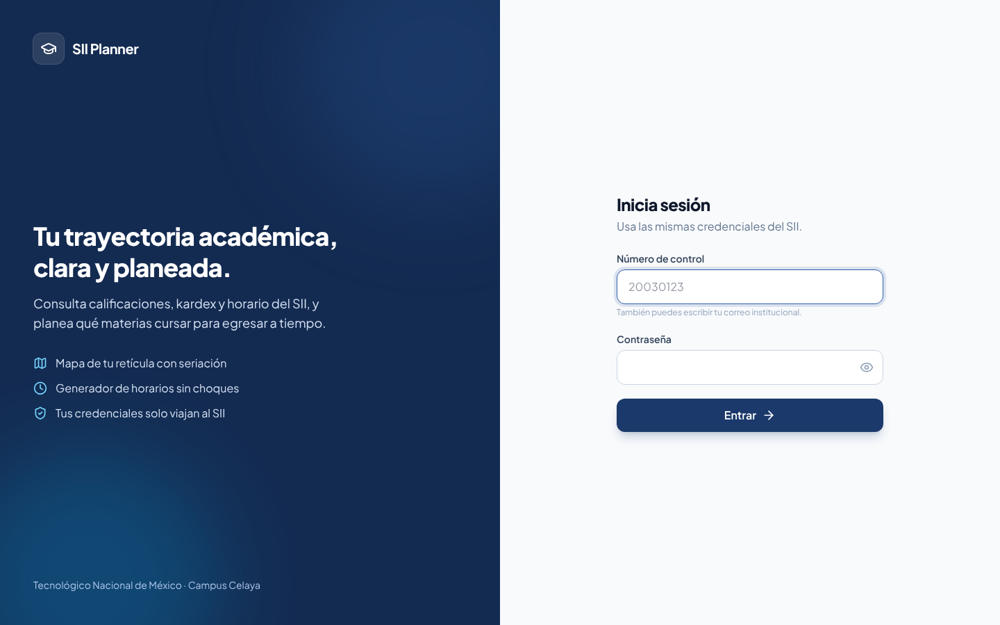 | 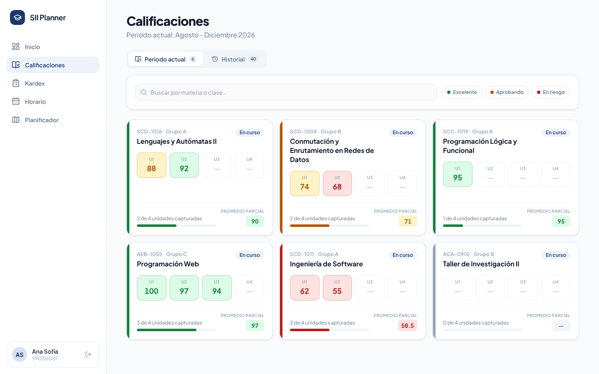 |
| **Historial con filtro en tiempo real** | **Kardex** |
| 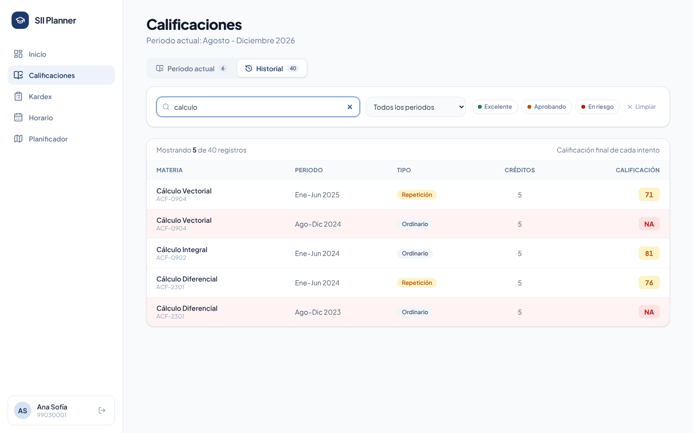 | 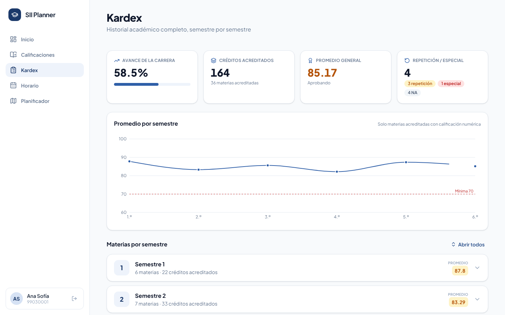 |
| **Horario** | **Planificador · Avance** |
| 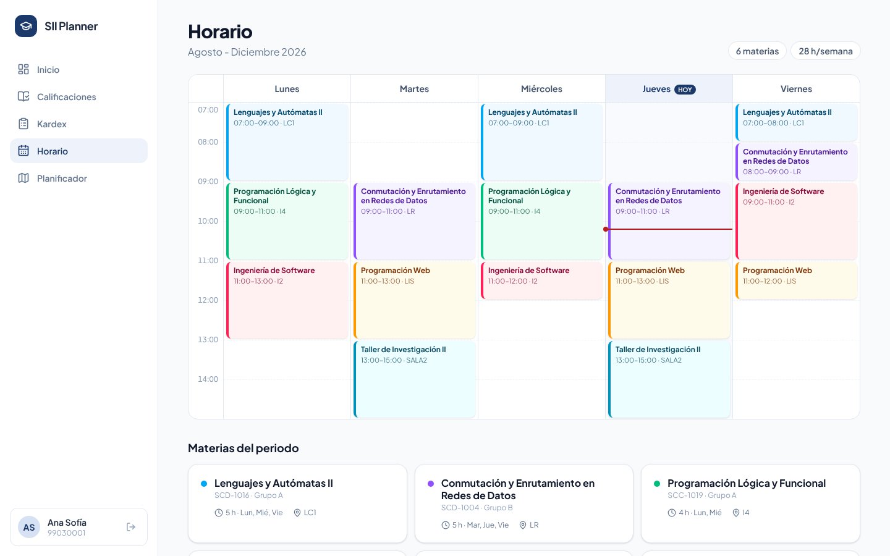 | 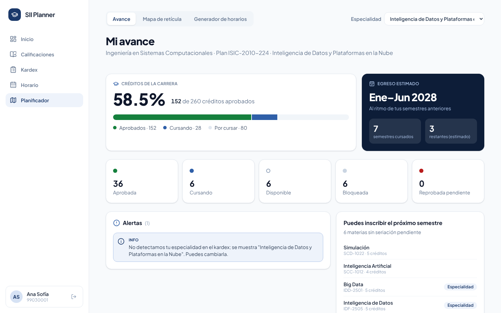 |
| **Planificador · Mapa de retícula** | **Mapa · detalle de una materia bloqueada** |
| 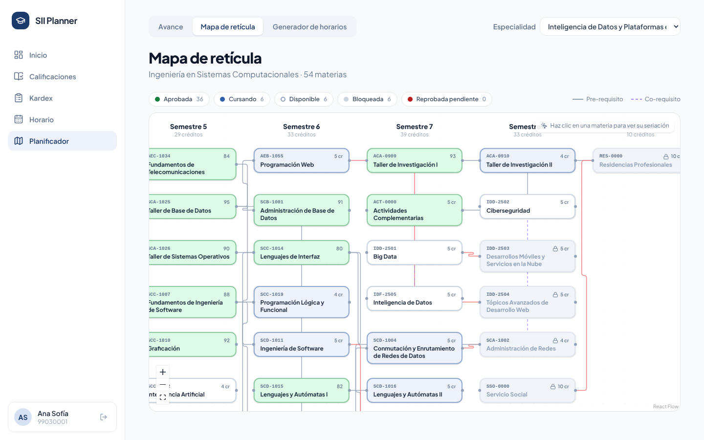 | 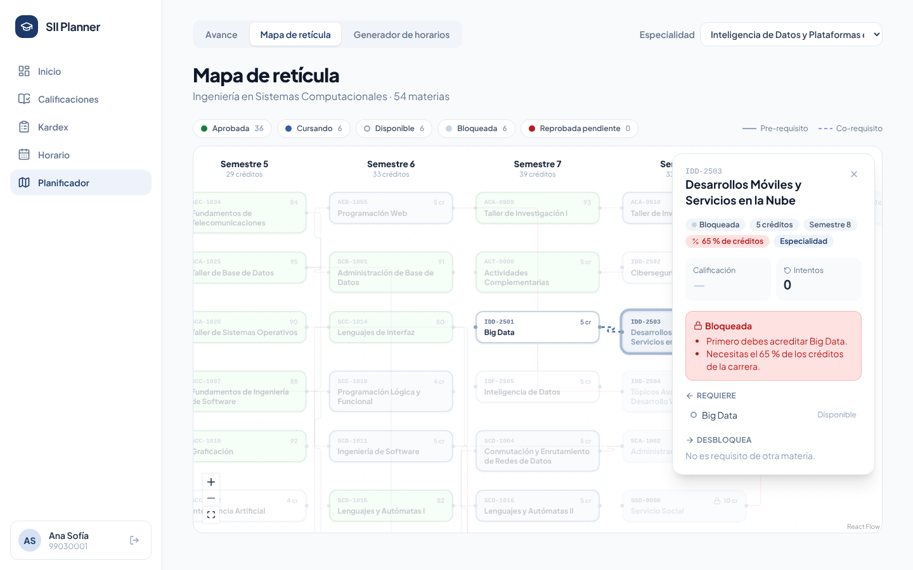 |
| **Planificador · Generador de horarios** | **Admin · Materias** |
| 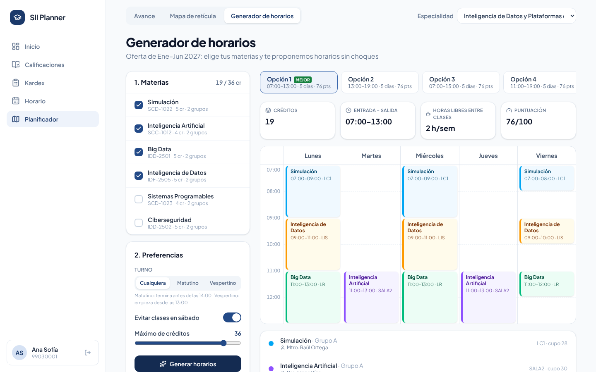 | 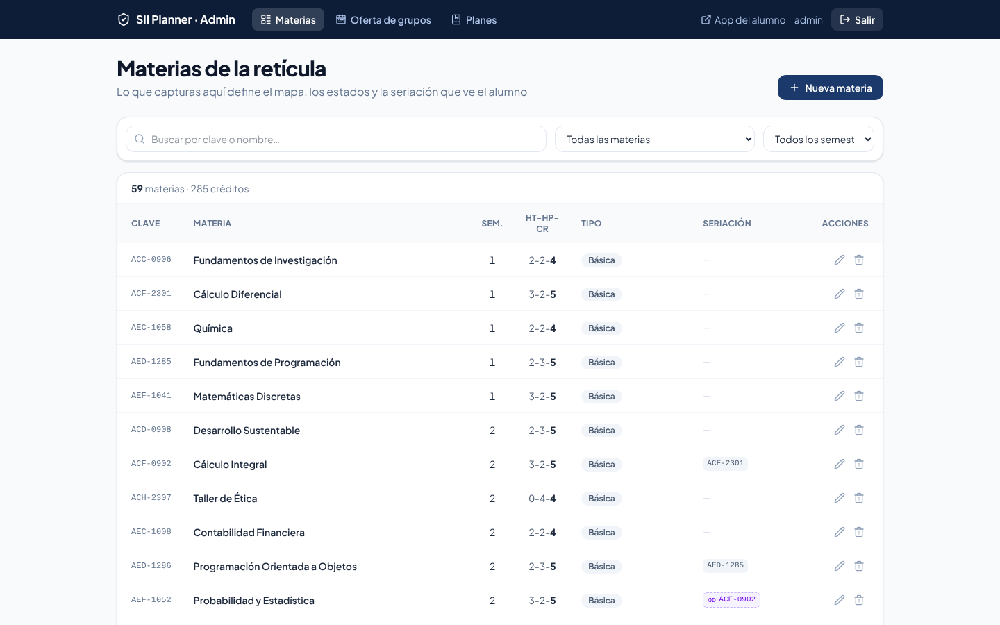 |
| **Admin · Materia con su seriación** | **Admin · Grupo con vista previa del horario** |
| 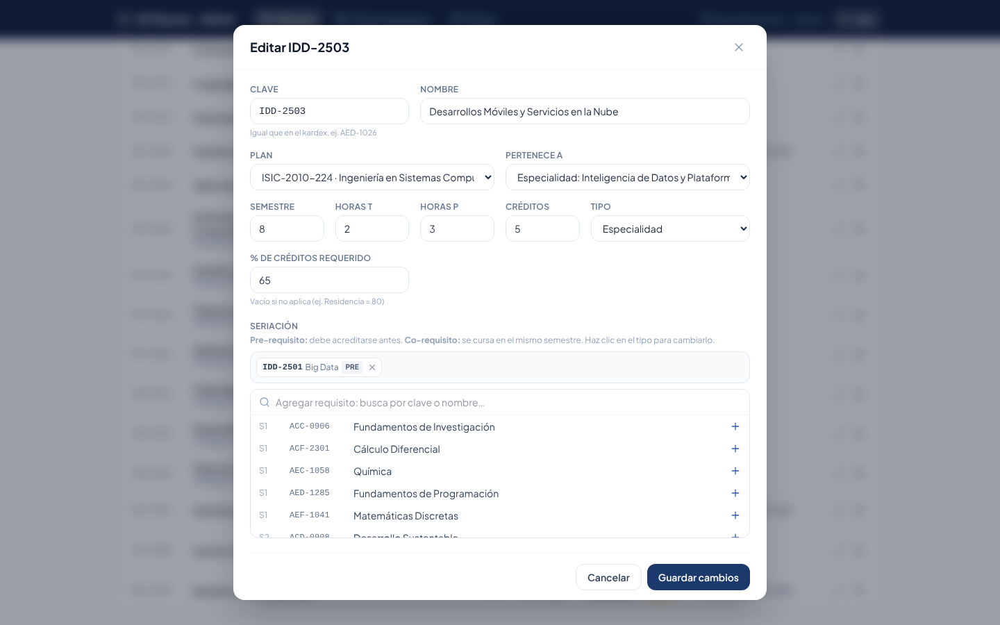 | 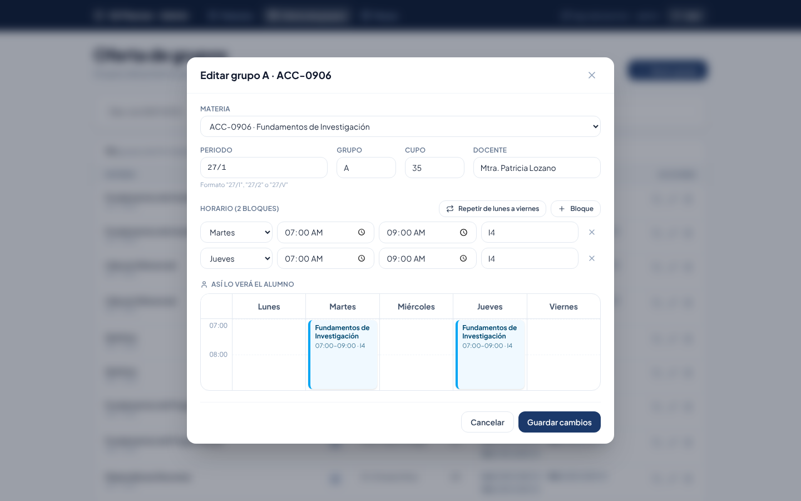 |

**En el celular**

| Calificaciones | Horario | Avance |
|---|---|---|
| 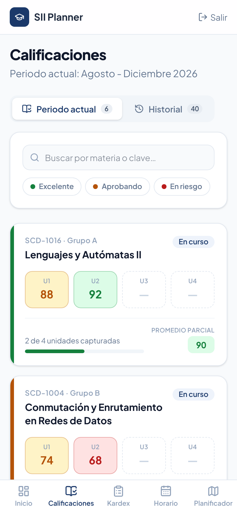 | 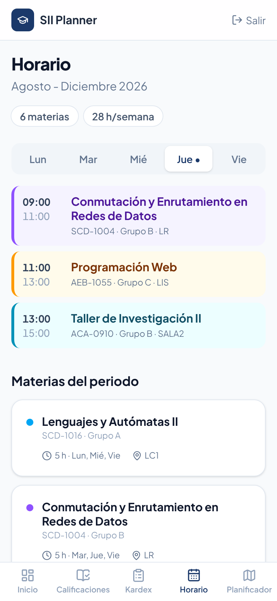 | 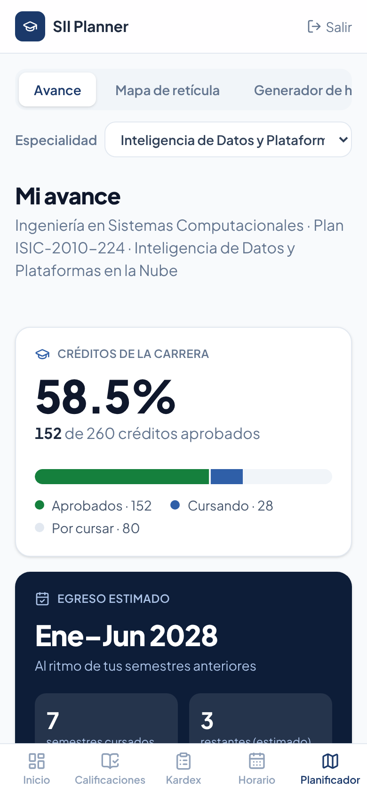 |

> Las capturas usan la **alumna ficticia** del modo mock; no contienen datos reales.

---

## Arquitectura

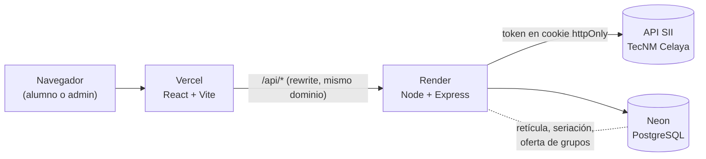

- La API del SII es la **única fuente de verdad** de la autenticación y de los datos académicos.
- Nuestro backend es el **intermediario seguro**: guarda el token en una cookie `httpOnly`, limpia las respuestas del SII
  (números como texto, errores de escritura como `calificaiones`, `"AC"` / `"0"`, periodos `23/V`…) y es el dueño de la lógica del Planificador.
- El frontend **solo** llama a `/api/...`; nunca al SII directamente.
- Vercel reenvía `/api/*` a Render con un *rewrite*: frontend y API quedan en el **mismo dominio**, así que no hay CORS
  y la cookie funciona también en Safari.

**Flujo de inicio de sesión**

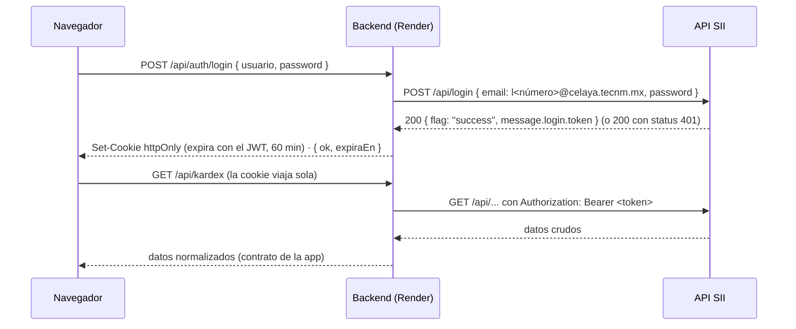

---

## Tecnologías y por qué las elegimos

| Capa | Tecnología | Por qué |
|---|---|---|
| Frontend | **React 19 + Vite + TypeScript** | SPA rápida con recarga instantánea (HMR) en desarrollo y build optimizado. TypeScript comparte el **contrato de datos** con el backend y atrapa errores antes de ejecutar. |
| Estilos | **Tailwind CSS 4** | Diseño consistente con tokens propios (azul institucional y semáforo de desempeño) sin escribir CSS a mano; responsivo desde el celular. |
| Datos en el front | **TanStack Query** | Caché, estados de carga y error, y reintentos sin código repetido; cada pantalla usa un hook (`useKardex()`, `useAvance()`…). |
| Rutas | **React Router** | Rutas independientes para cada sección y rutas protegidas para alumno y administrador. |
| Gráficas | **Recharts** | Gráfica del promedio por semestre en el Kardex, declarativa y fácil de integrar con React. |
| Mapa de seriación | **React Flow** (`@xyflow/react`) | Grafo interactivo (zoom, arrastre, selección) para dibujar la retícula con sus flechas de seriación. |
| Íconos | **lucide-react** | Íconos ligeros y consistentes. |
| Backend | **Node.js + Express 5 + TypeScript** | Intermediario seguro con el SII y API del Planificador; mismo lenguaje que el frontend. |
| Base de datos | **PostgreSQL**: **Neon** en producción, **PGlite** en desarrollo | Relacional, ideal para materias, requisitos y grupos. En local no hay que instalar nada: PGlite corre PostgreSQL dentro de Node, y las tablas y la retícula se crean solas al arrancar. |
| Despliegue | **Vercel** (front) · **Render** (API) · **Neon** (BD) | Planes gratuitos, despliegue automático desde GitHub y arquitectura de dos capas visible. |

---

## Instalación local

**Requisitos:** Node.js 20 o superior y Git.

```bash
git clone https://github.com/ricardo-rodriguezdesk/Examen3TOPW.git
cd Examen3TOPW
```

**1. Backend** (terminal 1)

```bash
cd backend
npm install
cp .env.example .env
```

En `backend/.env` cambia `SII_MODE=real` por `SII_MODE=mock` para usar la alumna ficticia (no hace falta cuenta del SII).
Deja `DATABASE_URL` vacío para usar PGlite.

```bash
npm run dev          # → http://localhost:4000/api/salud
```

**2. Frontend** (terminal 2, desde la raíz del repo)

```bash
cd frontend
npm install
npm run dev          # → http://localhost:5173
```

Vite reenvía `/api/*` al backend local (`vite.config.ts`), igual que el rewrite de Vercel en producción.

### Credenciales de prueba

| Dónde | Usuario | Contraseña |
|---|---|---|
| App (modo mock) | `99030001` | `demo123` |
| Panel de administración (local) | `admin` | `admin123` |

Para usar datos reales, pon `SII_MODE=real` en **tu** `.env` y entra con **tus** credenciales del SII.

### Variables de entorno del backend

| Variable | Ejemplo | Para qué |
|---|---|---|
| `PORT` | `4000` | Puerto del backend |
| `SII_MODE` | `real` · `mock` | API real del SII o alumna ficticia |
| `SII_BASE_URL` | `https://sii.celaya.tecnm.mx/api` | Base de la API del SII |
| `SII_EMAIL_DOMAIN` | `celaya.tecnm.mx` | Para armar el correo a partir del número de control |
| `FRONTEND_ORIGIN` | `http://localhost:5173` | Origen permitido en desarrollo |
| `NODE_ENV` | `development` · `production` | En producción la cookie es `Secure` |
| `DATABASE_URL` | *(vacío)* | Vacío = PGlite local; en producción, la URL de Neon |
| `ESPECIALIDAD_POR_DEFECTO` | `ISIE-IDP-2025-01` | Especialidad si no se detecta con el kardex |
| `ADMIN_USER` · `ADMIN_PASSWORD` | `admin` · `admin123` | Acceso al panel de administración |
| `ADMIN_SECRET` | texto largo aleatorio | Firma de la cookie del administrador |

---

## Despliegue

| Servicio | Qué corre | Configuración |
|---|---|---|
| **Vercel** | `frontend/` | Build `npm run build`, salida `dist/`. `frontend/vercel.json` reenvía `/api/*` a Render y el resto a `index.html`. |
| **Render** | `backend/` | Build `npm install && npm run build`, inicio `npm start`. Variables de entorno de la tabla anterior con `NODE_ENV=production` y `SII_MODE=real`. |
| **Neon** | PostgreSQL | `DATABASE_URL` en Render. Las tablas y la retícula se crean al primer arranque. |

Comprobaciones: `/api/salud` (vida), `/api/salud/sii` (¿Render alcanza al SII?) y `/api/salud/bd` (motor y conteo de materias y grupos).

---

## Estructura del repositorio

```
├── backend/                 API (Express + TS) — ver backend/README.md para los endpoints
│   └── src/
│       ├── routes/          auth, academico, planificador, admin
│       ├── sii/             cliente del SII, normalizadores, tipos y modo mock
│       ├── planificador/    lógica pura: estados, egreso, alertas, generador de horarios
│       ├── db/              conexión (Neon / PGlite), esquema y retícula oficial
│       └── middleware/      sesión del alumno y del administrador
├── frontend/                SPA (React + Vite + TS)
│   └── src/
│       ├── api/             cliente fetch y hooks de TanStack Query
│       ├── components/      UI compartida y HorarioGrid
│       ├── pages/           Login, Inicio, Calificaciones, Kardex, Horario, planificador/, admin/
│       ├── lib/             semáforo de desempeño, formato y estilos del Planificador
│       └── types/api.ts     contrato con el backend
├── docs/                    capturas y propuesta del Planificador
└── CONTEXTO.md              decisiones, contratos y reparto de trabajo del equipo
```

---

## Equipo

| Integrante | Responsabilidades |
|---|---|
| **Ricardo Rodríguez Arellano** ([ricardo-rodriguezdesk](https://github.com/ricardo-rodriguezdesk)) | Backend e integración con el SII, autenticación y seguridad del token, base de datos y retícula oficial, lógica del Planificador, Inicio, Horario y despliegue. |
| **Victor Manuel Mendoza Lara** ([Victorml55](https://github.com/Victorml55)) | Calificaciones, Kardex, frontend del Planificador (Avance, Mapa, Generador), panel de administración, documentación y propuesta. |

Instituto Tecnológico de Celaya · Tecnológico Nacional de México · 2026
